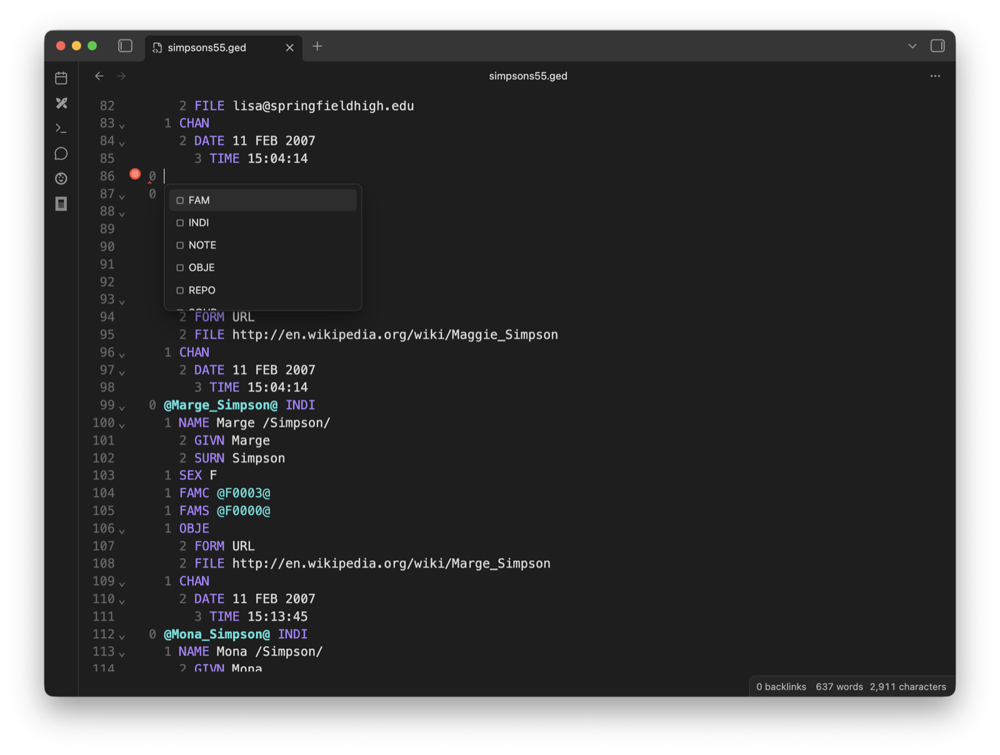

# GEDCOM for Obsidian

[](https://github.com/lavich/domorium-obsidian/releases)
[](LICENSE)

GEDCOM language support by Domorium. Read a `.ged` or `.gedcom` file as
genealogy — people, families, sources and what each fact rests on — and edit its
source directly in Obsidian with validation, autocomplete, navigation, folding,
and semantic highlighting.



Part of [Domorium](https://github.com/lavich/domorium). The same GEDCOM language
support runs in [VS Code](https://marketplace.visualstudio.com/items?itemName=domorium.gedcom),
[JetBrains IDEs](https://plugins.jetbrains.com/plugin/index?xmlId=domorium.gedcom),
and [in the browser](https://domorium.com/) — one implementation of the format,
adapted per editor.

## Features

- A Genealogy mode that shows the file as people and sources: a page per
  person with their facts, names and family, a page per source, an index of
  everyone in the file, and an evidence panel for what a fact rests on
- Context-aware GEDCOM tag autocomplete
- Real-time validation errors and warnings
- Semantic highlighting for levels, tags, and cross-references
- Documentation tooltips for GEDCOM tags
- Go to definition for XREF values
- Find XREF references and highlight declarations and usages
- Safe XREF rename as one undoable edit
- Web links and vault-relative file links
- Photographs previewed from a `FILE` payload, cropped to the part of the image
  a multimedia link asks for
- Quick fixes for broken references and invalid levels
- Folding and visual indentation for nested records
- Highlighted and checked `gedcom` code blocks in notes
- Links from a note to a record, indexed by the vault or as an `obsidian://` URL
- Desktop and mobile Obsidian support

The plugin keeps the GEDCOM file as the source of truth. It does not convert
records into Markdown, create a second genealogy database, or send vault data
to a remote service.

## Usage

1. Enable **GEDCOM** in **Settings → Community plugins**.
2. Open a `.ged` or `.gedcom` file in your vault. It opens in **Genealogy**
   mode, on the first person the file declares.
3. Switch to **Source** from the view header, or with **Switch between
   genealogy and source**, to edit the file. Obsidian saves changes back to the
   same file.

Genealogy mode reads the file and never writes to it. A person's page lists
their facts in the order the record states them, each marked with how many
sources it cites itself, or that it cites none; their other names; and their
parents, siblings, spouses and children, each of whom opens their own page.
Back and forward move between the pages you visited. **Show in source** on a
page, a fact or a missing relative switches to Source with exactly those lines
selected, which is where a correction is made.

The ribbon icon, or **Open Domorium**, puts an index of the file's
people, families and sources in the left sidebar: search by name, year or
place, and a filter for the people whose records cite no source at all. A row
opens its page in Genealogy mode, and in Source mode puts the cursor on the
record's first line instead. **Open the evidence
panel** puts the selected fact's sources in the right sidebar, kept apart from
the sources of the whole record so that one is never mistaken for the other.
On a phone the two are the left and right drawers, and tapping a fact shows
the gist beneath it.

A tab remembers whether it was in Genealogy or Source. **Open GEDCOM files as**
in the plugin settings chooses which mode a newly opened file starts in; set it
to Source to keep the editor as the default.

Use **Go to GEDCOM definition** from the command palette to jump from an XREF
usage to its record declaration. **Find GEDCOM references** moves between
matching declarations and usages, and **Rename GEDCOM reference** updates the
current XREF atomically. Editor behavior can be adjusted in the plugin settings.

A record pasted into a note is highlighted and checked when it is fenced as
`gedcom`. A block carries no header, so it is read as GEDCOM 7 unless the fence
names another specification — ```` ```gedcom 5.5.1 ````.

A note can link to a record. **Copy link to record** puts
`[[tree.ged#@I47@|Marie /Curie/]]` on the clipboard — a link the vault indexes,
so the file's Backlinks pane lists the notes that mention it and the graph draws
an edge to each. It is spelt the way this vault spells its own links, and shows
the name the record carries rather than a path. **Copy Obsidian URL to
record** writes the `obsidian://domorium?vault=…&file=…&xref=@I47@` form instead,
which a browser or another application can follow. Either one opens the file with
the cursor on that record.

Hovering a `FILE` payload shows the photograph it names, and hovering the
pointer of `1 OBJE @O1@` shows the part of that photograph the link's `CROP`
asks for — so one group portrait shows a different face under each person who
references it. Media that is not an image is named rather than drawn, and a
`FILE` naming a web address says so instead of being fetched. **Media preview**
in the plugin settings chooses the gesture, or turns it off, independently of
**Record preview**. Both open on a resting hover by default; either can be set
to ask for Ctrl/Cmd instead, and a gesture already chosen is kept.

Typing `[[tree.ged#` in a note offers the records in that file, by name where
the format gives one. Hovering a link to a record shows the record, highlighted,
without opening the file, and `![[tree.ged#@I47@]]` embeds it in the note the
same way.

## A vault to try it on

[`demo-vault/`](demo-vault) is an Obsidian vault: open it with **Open folder as
vault**, enable the plugin, and start from `Start here.md`. Four generations of
the Curie family live in one GEDCOM file — seventeen people, five families,
sources, repositories and images — and the notes around it link into it the way
your own notes would.

## For dataviewjs and other plugins

The parsed document is reachable without opening the file:

````
```dataviewjs
const api = app.plugins.plugins["domorium"].api;
const tree = await api.read("family/tree.ged");
dv.list(tree.getNodes().filter((n) => n.tokens.TAG?.value === "INDI")
  .map((n) => tree.getLabel(n) ?? n.tokens.XREF?.value));
```
````

`api.parse(text, options)` does the same for text already in hand. Both answer
with the validator's `GedcomDocument`: `getNodes`, `getErrors`, `getVersion`,
`getLabel`, `getPointerTargetTag`, `isRecordDeclaration`. `api.version` says
which API you are holding.

## Privacy

GEDCOM by Domorium works locally inside the vault. It does not require an account, access
files outside the vault, show advertisements, or collect analytics or
telemetry.

It makes no network request until you ask it to. There is one thing you can
ask for: **Load images from the web**, off until you turn it on, which lets the
media preview draw a `FILE` payload naming an `https` address. Until then the
preview says the file is remote and fetches nothing, and offers to draw it —
this one, or every one from now on. Nothing else reaches the network, an
unencrypted `http` address is refused whatever the setting says, and no
photograph is copied into the vault.

## Installation

Install **GEDCOM** from Obsidian's Community Plugins directory. To test beta
releases, use [BRAT](https://github.com/TfTHacker/obsidian42-brat) with this
repository URL:

```text
https://github.com/lavich/domorium-obsidian
```

For a manual installation, copy `main.js`, `manifest.json`, and `styles.css`
from the latest release into:

```text
<vault>/.obsidian/plugins/domorium/
```

Reload Community Plugins and enable **GEDCOM**.

## Development

```bash
npm install
npm run check
```

The packaged plugin is written to `dist/`.

The shared GEDCOM parser and editor-independent language service are maintained in the main
[Domorium repository](https://github.com/lavich/domorium) and consumed as
versioned public npm packages.

## License

MIT © 2026 Andrei Lobanov

Domorium is an independent project and is not affiliated with or endorsed by
FamilySearch or Intellectual Reserve, Inc. FAMILYSEARCH GEDCOM™ and FAMILYSEARCH®
are trademarks of Intellectual Reserve, Inc.
