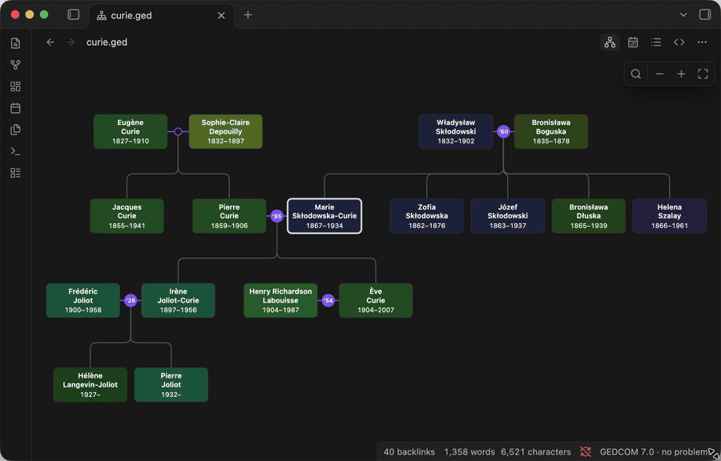
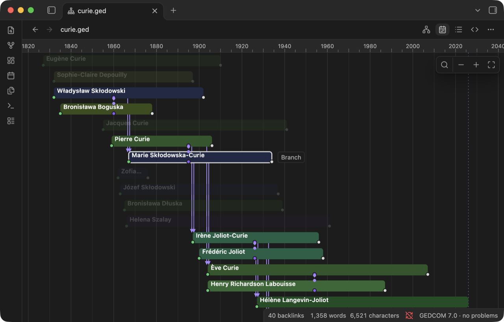
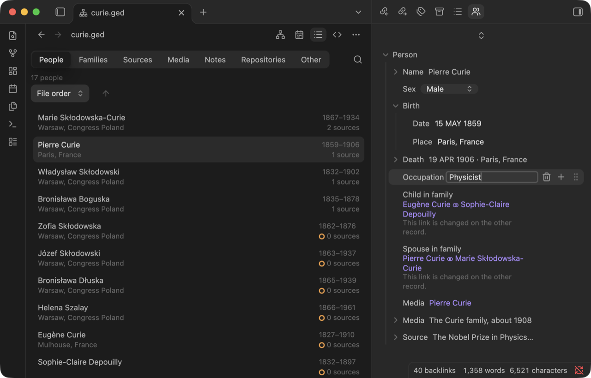

# GEDCOM for Obsidian

[](https://github.com/lavich/domorium-obsidian/releases)
[](LICENSE)

GEDCOM language support by Domorium. Read a `.ged` or `.gedcom` file as
genealogy — a family graph, a timeline of lives, a list of its records and a
card that edits each record's own lines — and edit its source directly in
Obsidian with validation, autocomplete, navigation, folding, and semantic
highlighting.



Part of [Domorium](https://github.com/lavich/domorium). The same GEDCOM language
support runs in [VS Code](https://marketplace.visualstudio.com/items?itemName=domorium.gedcom),
[JetBrains IDEs](https://plugins.jetbrains.com/plugin/index?xmlId=domorium.gedcom),
and [in the browser](https://domorium.com/) — one implementation of the format,
adapted per editor.

## Features

**Genealogy interface (beta)** — a GEDCOM tab has four modes: **Graph**,
**Timeline**, **List** and **Source**.

- **Graph** — a card per person, generations from top to bottom, tinted by
  surname; spouses joined at the year of their marriage. **Branch** narrows it to
  one person's ancestors, descendants and their spouses.
- **Timeline** — each life a bar from birth to death; a click draws the lines to
  a person's parents, spouses and children, and a year cursor gives everyone's age.
- **List** — people, families, sources, media, notes, repositories and other
  records, sorted and filtered.
- **Record card** — the selected record as a tree of its own lines, in the
  file's order and in your language. Values are edited in place, lines are added,
  removed and dragged, and every change is one undo in Source.





**In the source**

- Context-aware tag autocomplete, and validation against GEDCOM 5.5.1 and 7.0 as
  you type
- Semantic highlighting, tag documentation on hover, folding and indentation hints
- Go to definition, find references and safe rename of cross-references
- Quick fixes for broken references and invalid levels
- Clickable web links and vault-relative file links
- Photographs previewed from a `FILE` payload, cropped to what a link's `CROP`
  asks for

**In notes**

- Links from a note to a record — `[[tree.ged#@I47@]]` or an `obsidian://` URL —
  with a preview on hover and embeds
- Highlighted and checked `gedcom` code blocks

Desktop and mobile. The plugin keeps the GEDCOM file as the source of truth. It
does not convert records into Markdown, create a second genealogy database, or
send vault data to a remote service.

## Getting started

1. Enable **GEDCOM** in **Settings → Community plugins**.
2. Open a `.ged` or `.gedcom` file in your vault. It opens in **Graph** mode; the
   buttons in the tab's header switch between the four modes.
3. Select a person, a family or any record to see its card in the right sidebar.

The genealogy interface is still a beta. To work in the source editor alone,
turn off **Genealogy interface (beta)** in the plugin settings.

Every mode, command and setting is described in the
**[full guide](https://github.com/lavich/domorium-obsidian/blob/main/docs/usage.md)**.

## A vault to try it on

[`demo-vault/`](demo-vault) is an Obsidian vault: open it with **Open folder as
vault**, enable the plugin, and start from `Start here.md`. Four generations of
the Curie family live in one GEDCOM file — seventeen people, five families,
sources, repositories and images — and the notes around it link into it the way
your own notes would.

## For dataviewjs and other plugins

The parsed document is reachable without opening the file:

````
```dataviewjs
const api = app.plugins.plugins["domorium"].api;
const tree = await api.read("family/tree.ged");
dv.list(tree.getNodes().filter((n) => n.tokens.TAG?.value === "INDI")
  .map((n) => tree.getLabel(n) ?? n.tokens.XREF?.value));
```
````

`api.parse(text, options)` does the same for text already in hand. Both answer
with the validator's `GedcomDocument`: `getNodes`, `getErrors`, `getVersion`,
`getLabel`, `getPointerTargetTag`, `isRecordDeclaration`. `api.version` says
which API you are holding.

## Privacy

GEDCOM by Domorium works locally inside the vault. It does not require an account, access
files outside the vault, show advertisements, or collect analytics or
telemetry.

It makes no network request until you ask it to. There is one thing you can
ask for: **Load images from the web**, off until you turn it on, which lets the
media preview draw a `FILE` payload naming an `https` address. Until then the
preview says the file is remote and fetches nothing, and offers to draw it —
this one, or every one from now on. Nothing else reaches the network, an
unencrypted `http` address is refused whatever the setting says, and no
photograph is copied into the vault.

## Installation

Install **GEDCOM** from Obsidian's Community Plugins directory. To test beta
releases, use [BRAT](https://github.com/TfTHacker/obsidian42-brat) with this
repository URL:

```text
https://github.com/lavich/domorium-obsidian
```

For a manual installation, copy `main.js`, `manifest.json`, and `styles.css`
from the latest release into:

```text
<vault>/.obsidian/plugins/domorium/
```

Reload Community Plugins and enable **GEDCOM**.

## Development

```bash
npm install
npm run check
```

The packaged plugin is written to `dist/`.

The shared GEDCOM parser and editor-independent language service are maintained in the main
[Domorium repository](https://github.com/lavich/domorium) and consumed as
versioned public npm packages.

## License

MIT © 2026 Andrei Lobanov

Domorium is an independent project and is not affiliated with or endorsed by
FamilySearch or Intellectual Reserve, Inc. FAMILYSEARCH GEDCOM™ and FAMILYSEARCH®
are trademarks of Intellectual Reserve, Inc.
