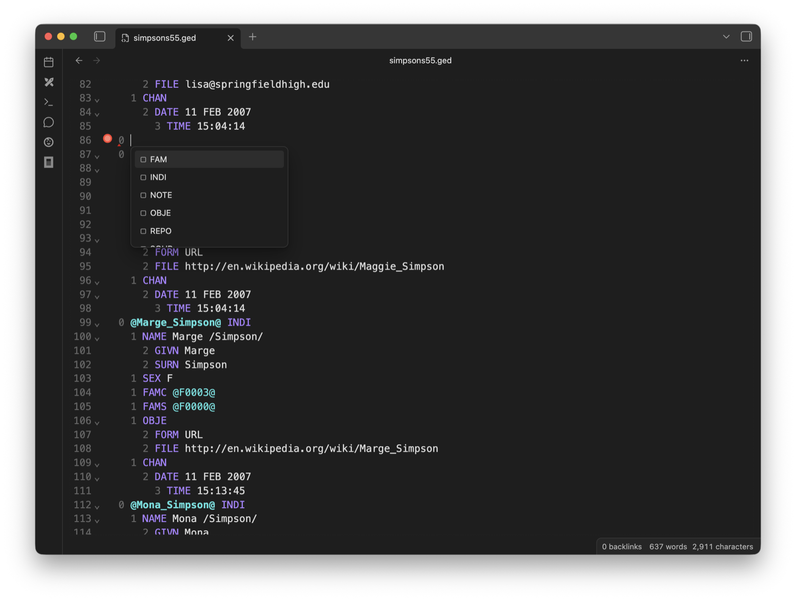

# GEDCOM for Obsidian

[](https://github.com/lavich/domorium-obsidian/releases)
[](LICENSE)

GEDCOM language support by Domorium. Read a `.ged` or `.gedcom` file as
genealogy — people, families, sources and what each fact rests on — and edit its
source directly in Obsidian with validation, autocomplete, navigation, folding,
and semantic highlighting.



Part of [Domorium](https://github.com/lavich/domorium). The same GEDCOM language
support runs in [VS Code](https://marketplace.visualstudio.com/items?itemName=domorium.gedcom),
[JetBrains IDEs](https://plugins.jetbrains.com/plugin/index?xmlId=domorium.gedcom),
and [in the browser](https://domorium.com/) — one implementation of the format,
adapted per editor.

## Features

- An optional genealogy interface, off until you turn it on: a graph and a
  timeline of the whole file, a sortable list of its people, families,
  sources and places, and a record card in the right sidebar that shows the selected person, family, source or media
  record with their facts, names, family, timeline and what each fact
  rests on
- Context-aware GEDCOM tag autocomplete
- Real-time validation errors and warnings
- Semantic highlighting for levels, tags, and cross-references
- Documentation tooltips for GEDCOM tags
- Go to definition for XREF values
- Find XREF references and highlight declarations and usages
- Safe XREF rename as one undoable edit
- Web links and vault-relative file links
- Photographs previewed from a `FILE` payload, cropped to the part of the image
  a multimedia link asks for
- Quick fixes for broken references and invalid levels
- Folding and visual indentation for nested records
- Highlighted and checked `gedcom` code blocks in notes
- Links from a note to a record, indexed by the vault or as an `obsidian://` URL
- Desktop and mobile Obsidian support

The plugin keeps the GEDCOM file as the source of truth. It does not convert
records into Markdown, create a second genealogy database, or send vault data
to a remote service.

## Usage

1. Enable **GEDCOM** in **Settings → Community plugins**.
2. Open a `.ged` or `.gedcom` file in your vault. It opens in the editor, and
   Obsidian saves changes back to the same file.
3. To read the file as people and sources, turn on **Genealogy interface (beta)**
   in the plugin settings; it is still a beta and may change. Files then open in
   **Graph** mode, and the mode buttons in the view header, with the commands
   **Show as graph**, **Show as timeline**, **Show as list** and **Show as
   source**, go between its four modes.

The next paragraphs — the modes of a tab and the record card — are
part of the genealogy interface and appear only while it is on; turning it off
hides it again and closes its panels without losing the mode a tab was in. The
editor features after them need no setting.

A GEDCOM tab shows its file in four modes — **Graph**, **Timeline**, **List**
and **Source** — which the four buttons in the tab's header choose, left to
right in that order, the current mode's in the accent colour. The commands
**Show as graph**, **Show as timeline**, **Show as list** and **Show as
source**, from the command palette or the tab's menu, do the same, and **Switch
between source and the last view** goes back and forth between Source and the
mode before it. The graph, the timeline and the list read the tab's own text, so
what is typed and not yet saved is already in them. **Find**, and its key, opens
the search of the mode the tab is in: the editor's panel in Source, the search
over the board in Graph and Timeline, and the filter field in List;
**Replace** stays in Source.

In **List** mode the tab shows the file's people, families, sources, places or events as a
table, switched by the buttons at its top. People show name, years, place and
how many sources the record cites, with a mark where it cites none; families
show the spouses, the year and place of the marriage and the number of
children; sources show the title, author, repository and how many records cite
them; places lists each place the file names once, however it is spelt in case or
spacing, with its number of events and their years; events lists every event of the
people and families, an occupation or an award with its text, with its record, date
and place. A click on a column header sorts by it, a second click reverses the order
and a third restores the file's; a filter field narrows the rows by name, year
and place. Sorting people by Sources puts those whose records cite no source
first. A count says how many rows are shown. Clicking a row, or pressing Enter
or Space on it, selects that record; on a place it shows its card with its events, and on an event
its card with its record, date, place and sources. The row of the selected record is marked
and brought into view when it was selected elsewhere. The arrow keys, Home,
End and the page keys move through the rows. A file of twenty thousand people
draws only the rows in view. On a phone, and in a tab narrower than
640 pixels, each row takes two lines and a selector with a direction button
replaces the column headers.

A tab selects one record at a time, and the **record card** in the right sidebar
shows it, whatever the mode. While **Open the record card when selecting** is on, which it is by default,
clicking a card, a node, a row or a link opens the card in the right sidebar,
putting it there if it is closed and expanding a collapsed sidebar, and the view
you clicked in keeps the focus; a card already open is left alone, and one you
collapse or close comes back with the next click. The left sidebar is never
opened. Following the cursor in Source and moving inside the card open
nothing. With it off, the first selection in a session puts the card in the
right sidebar without expanding it. **Show the record
card** brings it back, opens a collapsed sidebar and gives it the focus; on a
phone it is in the right drawer, which a second touch on a card, or a tap on a
row of the list, opens. A person's card lists their facts in the order the record states
them, each marked with how many sources it cites itself where it cites any, and
a line above them saying how many have none; their other names; their parents,
siblings, spouses and children, each of whom selects that person; their media; a
**timeline** of their events and their close relatives', folded under its heading,
which shows how many it holds, and closed when a card opens; and last the
**evidence** — what the whole record rests on. Tapping a fact, or
an entry of the timeline, opens the card of its event: the person or the family it
belongs to as a link above its name, its date and place under it, and the evidence
that is its own below; a place named there opens the card of that place, which lists
the events held there as the facts of a person are listed, and a list in view
shows the event or the place. Every control of a card shows a focus ring for the
keyboard and, on a phone, can be hit over at least 32 pixels, a block button over 44. A family, a
source, a place, an event and a media record have cards of their own, and **Back** and **Forward** in
the card's header go between the records it showed. The card reads the file and
never writes to it. **Show in source** on a card, a fact or a missing relative
switches to Source with exactly those lines selected, which is where a
correction is made.

What selects a record: a click or tap on a card or a node in Graph, or a bar in
Timeline, marks the person and shows the card without moving the
view, and a click on a row in List marks the row; a link to a record and **Go to
record** also glide to the person or bring the row into view; a relative, a
citation or a tile in the card selects that record. In
Source a link or the card puts the cursor on the record's
first line, and the cursor, once it rests in a record that has a card, selects
it — a note or a repository at the cursor leaves the selection alone. The
selection is kept when the tab changes mode and across a restart.

The command **Open the list of the GEDCOM file** brings the GEDCOM tab
you used last to the front as a list, wherever it is; with no GEDCOM tab open it
says so.

In **Timeline** mode the tab shows each person as a bar on an axis of years, from
birth to death, with their name written inside it and no years on it. Each person has a row of their own, in the order of
generations. A bar takes its colour from
the surname — `Лобанов` and `Лобанова` look alike, `Лобанов` and `Сидорова` do
not — and a person with no surname is grey. A soft end means the date is
approximate; a bar with no recorded death fades out a hundred years after it
begins, while one that begins at a birth in the last hundred years runs to the
present in a straight cut edge, as the bar of a person who may be alive. A name too long for its bar is cut with an ellipsis inside it, and pointing at a bar shows the whole name. Dated events are marks along the bar's lower edge, an approximate
date is drawn dashed and a period as a span; a person with no dated event has no
bar. Clicking a bar selects the person and picks out their whole branch — all their
ancestors and descendants and the spouses of each — with a line and an arrowhead
from each parent down to each child, and a dashed line with a dot at each end to a
spouse at the year of the marriage. A year cursor gives the age everyone alive
reached that year, and the selected person's age on the axis. A search icon over
the board opens into a field that fades everyone else and steps from match to
match with arrows, and the zoom buttons widen, narrow or fit the years; on a
phone a pinch zooms the axis. **Branch**, on the selected bar or from the command
**Branch of the selected person**, narrows the board to one person's ancestors
and descendants (all generations), and a file of more than 500 people opens on the branch of the
person selected. An event shows its lines in Source. On a phone the first touch
picks a person out and places the year cursor, and a second touch selects them.

In **Graph** mode the tab shows a card per person, generations from top to
bottom and tinted by surname, as the bars of the timeline are. Spouses stand side by side, a husband to
the left of his wife, joined by a node with the year of their marriage — hollow
where it is undated — from which curved lines run to their children; the
husband's family tends to stand on the left and the wife's on the right, and the
rows are ordered to cross as few lines as it can find. The graph is laid out by
family: people are grouped into the families the file declares — adoptive and
foster links, several marriages and unknown parents included, though the graph
draws every link alike — before any card is placed, and a person who belongs to
several families stays one card. Pointing at a person
lights their whole branch, as the timeline does; pointing at a node shows the
marriage and the number of children. Drag or scroll with two fingers to move,
use the wheel or pinch to zoom, and **Fit** to see the whole scope; far out the
cards are drawn without names. The search, **Branch** and the 500-person rule
work as in the timeline. A card selects the person, a node the family, and every
card and node can be reached and activated from the keyboard.

Each tab remembers its mode and its selected record, and the branch, position and
zoom of its graph and its timeline, across a restart. A file
opened in a new tab, or a tab navigated to another file, starts in the mode you last
chose in a GEDCOM tab with the header buttons or a **Show as** command — Graph the
first time — so working in Source or in Timeline carries over from file to file.
Only a choice of yours counts: opening a file, restoring a workspace or Back never
changes it.

Use **Go to GEDCOM definition** from the command palette to jump from an XREF
usage to its record declaration. **Find GEDCOM references** moves between
matching declarations and usages, and **Rename GEDCOM reference** updates the
current XREF atomically. Editor behavior can be adjusted in the plugin settings.

A record pasted into a note is highlighted and checked when it is fenced as
`gedcom`. A block carries no header, so it is read as GEDCOM 7 unless the fence
names another specification — ```` ```gedcom 5.5.1 ````.

A note can link to a record. **Copy link to record** puts
`[[tree.ged#@I47@|Marie /Curie/]]` on the clipboard — a link the vault indexes,
so the file's Backlinks pane lists the notes that mention it and the graph draws
an edge to each. It is spelt the way this vault spells its own links, and shows
the name the record carries rather than a path. **Copy Obsidian URL to
record** writes the `obsidian://domorium?vault=…&file=…&xref=@I47@` form instead,
which a browser or another application can follow. Either one opens the file with
the cursor on that record.

Hovering a `FILE` payload shows the photograph it names, and hovering the
pointer of `1 OBJE @O1@` shows the part of that photograph the link's `CROP`
asks for — so one group portrait shows a different face under each person who
references it. Media that is not an image is named rather than drawn, and a
`FILE` naming a web address says so instead of being fetched. A `FILE` payload
is read by its file's GEDCOM version, so in GEDCOM 7 `photos/my%20photo.jpg`
names `photos/my photo.jpg`, and a vault file that is renamed or moved is
followed into the payloads naming it — as is a renamed folder, and a GEDCOM file
moved to another folder, whose payloads are spelled again from where it now
stands — or a notice says how many it could not follow. **Media preview**
in the plugin settings chooses the gesture, or turns it off, independently of
**Record preview**. Both open on a resting hover by default; either can be set
to ask for Ctrl/Cmd instead, and a gesture already chosen is kept.

Typing `[[tree.ged#` in a note offers the records in that file, by name where
the format gives one. Hovering a link to a record shows the record, highlighted,
without opening the file, and `![[tree.ged#@I47@]]` embeds it in the note the
same way.

## A vault to try it on

[`demo-vault/`](demo-vault) is an Obsidian vault: open it with **Open folder as
vault**, enable the plugin, and start from `Start here.md`. Four generations of
the Curie family live in one GEDCOM file — seventeen people, five families,
sources, repositories and images — and the notes around it link into it the way
your own notes would.

## For dataviewjs and other plugins

The parsed document is reachable without opening the file:

````
```dataviewjs
const api = app.plugins.plugins["domorium"].api;
const tree = await api.read("family/tree.ged");
dv.list(tree.getNodes().filter((n) => n.tokens.TAG?.value === "INDI")
  .map((n) => tree.getLabel(n) ?? n.tokens.XREF?.value));
```
````

`api.parse(text, options)` does the same for text already in hand. Both answer
with the validator's `GedcomDocument`: `getNodes`, `getErrors`, `getVersion`,
`getLabel`, `getPointerTargetTag`, `isRecordDeclaration`. `api.version` says
which API you are holding.

## Privacy

GEDCOM by Domorium works locally inside the vault. It does not require an account, access
files outside the vault, show advertisements, or collect analytics or
telemetry.

It makes no network request until you ask it to. There is one thing you can
ask for: **Load images from the web**, off until you turn it on, which lets the
media preview draw a `FILE` payload naming an `https` address. Until then the
preview says the file is remote and fetches nothing, and offers to draw it —
this one, or every one from now on. Nothing else reaches the network, an
unencrypted `http` address is refused whatever the setting says, and no
photograph is copied into the vault.

## Installation

Install **GEDCOM** from Obsidian's Community Plugins directory. To test beta
releases, use [BRAT](https://github.com/TfTHacker/obsidian42-brat) with this
repository URL:

```text
https://github.com/lavich/domorium-obsidian
```

For a manual installation, copy `main.js`, `manifest.json`, and `styles.css`
from the latest release into:

```text
<vault>/.obsidian/plugins/domorium/
```

Reload Community Plugins and enable **GEDCOM**.

## Development

```bash
npm install
npm run check
```

The packaged plugin is written to `dist/`.

The shared GEDCOM parser and editor-independent language service are maintained in the main
[Domorium repository](https://github.com/lavich/domorium) and consumed as
versioned public npm packages.

## License

MIT © 2026 Andrei Lobanov

Domorium is an independent project and is not affiliated with or endorsed by
FamilySearch or Intellectual Reserve, Inc. FAMILYSEARCH GEDCOM™ and FAMILYSEARCH®
are trademarks of Intellectual Reserve, Inc.
